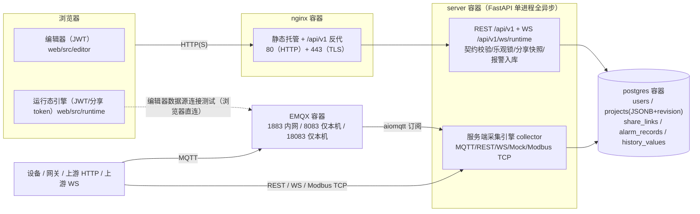

# webScada

Web 原生、轻量、低代码拖拽组态的实时监控大屏（开源核心 + 企业版双授权）。

> **当前阶段：`internal-pilot`（受限内部试点），不可商用售卖。**
> 依据 2026-10-20 商用就绪度评审（综合成熟度 2.2/5，详见
> [docs/assessment/commercial-readiness-2026-10-20.md](docs/assessment/commercial-readiness-2026-10-20.md)）。
> 当前仅可用于：非关键产线、**有人值守盯屏**、数据源无需鉴权或可自行维护凭证、
> 不向外部交付工程文件、不作任何升级承诺。商用路线见文末「路线图」。

面向中小工厂单机场景：组态编辑器 + 只读实时监控 + 报警展示，介于数据 BI 大屏与重型 SCADA 之间。

## 功能矩阵（诚实版）

| 能力 | 状态 |
|---|---|
| 拖拽组态编辑器（对齐吸附/50 步撤销/跨页粘贴/旋转缩放） | ✅ 已实现 |
| 41 种注册组件 + 75 个自绘行业图元（图元库 9 大类 + 画面装饰 7 件）、我的图元资产库、画面模板、数据绑定（数值/颜色/显隐）与状态动画 | ✅ 已实现 |
| 工程 CRUD + 乐观锁（409 冲突检测）+ 导入导出（凭证脱敏） | ✅ 已实现 |
| 多画面 + 编辑/运行分离 + 分享快照发布 | ✅ 已实现 |
| 反控写指令（开关/多档/输入框，变量显式 writable，分享页恒只读） | ✅ 已实现（M7） |
| 数据源接入：服务端常驻采集 MQTT / REST 轮询 / WebSocket / Mock / **Modbus TCP** / **OPC UA**（订阅推送 + 节点浏览；JSON 载荷） | ✅ 已实现（M8 / 阶段二） |
| 报警：阈值/回差/持续时间规则、**服务端 7x24 判定**、单行状态机 ack 流转、Webhook/邮件外发 | ✅ 已实现（M8） |
| 通讯中断一等报警：设备断线超阈值自动产生 critical 报警，恢复自动清除并外发恢复通知 | ✅ 已实现（阶段三） |
| 通知补发队列：渠道失败落 outbox 指数退避重试（上限转死信），断网恢复后自动补发 | ✅ 已实现（阶段三） |
| 历史趋势：服务端 historian（`history_values` 5s 采样 / 30 天保留 / 区间聚合查询）；浏览器 localStorage 桶降级为离线兜底 | ✅ 已实现（M8） |
| 带鉴权数据源运行态连接（凭证 Fernet 加密 + 测试注回通道） | ✅ 已实现（M8） |
| 服务端 7x24 采集 / 报警判定 / 历史入库 / WS 合帧推送 | ✅ 已交付（M8 服务端监控闭环，2026-10-20） |
| RBAC 用户管理（admin/operator/viewer）/ 八类操作审计 | ✅ 已实现（M8） |
| 工程模板克隆（复制工程：画面/绑定/报警/数据源/凭证原样复制，OEM 一模板 N 台设备） | ✅ 已实现（阶段三） |
| 点位 CSV 导入/导出/同 key upsert + 删除前引用阻断 | ✅ 已实现（阶段三） |
| 离线一体机交付包（镜像导出/离线安装/升级回滚/systemd 自启） | ✅ 脚本已落地（`deploy/appliance/`，未在真实气隙硬件长跑） |
| 全站 TLS / EMQX 强制鉴权 / 备份恢复 / CI | ✅ 止血包已落地（本轮） |
| 迁移三件套（migrateDoc / schemaVersion N-1 窗口 / 迁移前备份指引） | ✅ 机制已落地并有测试（`CURRENT_SCHEMA_VERSION` 冻结为 1，尚无实际 v2 迁移用例） |
| RTSP 转码视频 / 主备冗余 / 白标 OEM / License 机制 | 🗺 企业版规划（License 骨架已就绪，见 [NOTICE.md](NOTICE.md)） |

## 架构



技术栈：前端 Vue3 + TypeScript + Vite + Pinia + Element Plus + ECharts；
后端 FastAPI + PostgreSQL（异步 SQLAlchemy 2.0 + Alembic + Pydantic v2）；MQTT 经 EMQX；
部署 docker compose。设计契约文档见 [docs/design/](docs/design/00-总览.md)（权威）。

## 快速开始（Docker）

要求：Docker Desktop ≥ 4.30（Windows）或 Docker Engine ≥ 25 + Compose v2。
完整部署手册（镜像加速 / 常用命令 / 备份恢复 / 安全基线）见 [README.Docker.md](README.Docker.md)。

```bash
# 0.（可选）预生成自签证书；跳过则首次 up 时由 tls-init 自动生成
./scripts/gen-selfsigned-cert.sh

# 1. 准备环境变量
cp .env.example .env
#    必填：JWT_SECRET / DATASOURCE_SECRET / ADMIN_PASSWORD，以及建议覆盖的 EMQX_DEFAULT_PASSWORD
python -c "import secrets;print('JWT_SECRET='+secrets.token_hex(32))"
python -c "from cryptography.fernet import Fernet;print('DATASOURCE_SECRET='+Fernet.generate_key().decode())"

# 2. 构建并启动（首次拉取/构建镜像需数分钟；emqx-authn-init / tls-init 为一次性服务）
docker compose up -d --build

# 3. 验证
docker compose ps                                # postgres/emqx/server/nginx healthy
curl -k https://localhost/api/v1/health          # {"status":"ok",...}（或 http://localhost）
docker compose logs emqx-authn-init              # [emqx-authn-init] OK (...)

# 4. 浏览器访问
# https://localhost  →  ADMIN_USER / ADMIN_PASSWORD 登录（自签证书有「不受信任」警告，属预期）
```

### EMQX 鉴权后的首次配置

EMQX 已**禁用匿名连接**（`EMQX_MQTT__ALLOW_ANONYMOUS=false`，写死无旁路）：

1. compose 启动时 `emqx-authn-init` 会自动在 EMQX 内置数据库创建 MQTT 账号
   `EMQX_DEFAULT_USERNAME / EMQX_DEFAULT_PASSWORD`（默认 `webscada_mqtt / webscada_mqtt123`，
   **生产务必在 `.env` 覆盖**）。
2. 管理台仅本机可访问：`http://localhost:18083`，用 `EMQX_DASHBOARD_USER/PASSWORD`
   （默认 `admin/public`）登录，**首次登录立即改密**。
3. 在工程的数据源面板填写上述 MQTT 账号即可：运行态由服务端 collector 采集，
   凭证保存时 Fernet 加密入库，出口一律脱敏；编辑器里的「测试连接」也会按空值保留规则注回库内凭证。
4. 需要更多 MQTT 客户端账号时，在管理台「访问控制 → 客户端认证」中按最小权限创建，
   不要复用采集账号。

### TLS 说明

- nginx 已提供 443（TLS 1.2/1.3），证书挂载 `./deploy/certs/selfsigned.{crt,key}`：
  可用 `scripts/gen-selfsigned-cert.sh` 重新签发；生产环境替换为企业 CA / Let's Encrypt
  证书（同名替换后 `docker compose restart nginx`）。
- 80 端口保留供存量内网部署过渡；证书受信后可在 `deploy/nginx/nginx.conf` 的 80 块
  按注释收缩为 301 跳转。
- 自签阶段未启用 HSTS（避免锁死浏览器），启用可信证书后建议开启。

## 默认账号与安全提醒

| 账号 | 默认值 | 必须 |
|---|---|---|
| webScada 管理员 | `ADMIN_USER`（默认 `admin`）/ `ADMIN_PASSWORD`（**必填，无默认**） | 首次登录改密；**首次登录改密前系统处于暴露状态** |
| EMQX 管理台 | `admin` / `public` | 首次登录改密（仅本机 18083 可达） |
| MQTT 客户端 | `webscada_mqtt` / `webscada_mqtt123` | 生产环境在 `.env` 覆盖后重建 |

其他红线：`JWT_SECRET` / `DATASOURCE_SECRET` 弱值或泄漏 = 会话伪造 / 凭证库不可解；
`deploy/certs/` 含私钥，严禁提交 Git；`.env` 不入库（模板见 `.env.example`，
注意其中 EMQX 三个新变量尚未回填模板，见「已知限制」第 9 条）。

## 环境变量

| 变量 | 默认 | 说明 |
|---|---|---|
| `POSTGRES_USER/PASSWORD/DB` | webscada / webscada123 / webscada | PostgreSQL 初始凭据（仅首次建库生效） |
| `JWT_SECRET` | **必填** | JWT HS256 签名密钥 |
| `JWT_EXPIRE_HOURS` | 2 | JWT 有效期；7x24 大屏走分享链接不受此限 |
| `DATASOURCE_SECRET` | **必填** | 数据源凭证 Fernet 加密密钥；**丢失后已存凭证不可解，需在各数据源面板重填** |
| `ADMIN_USER / ADMIN_PASSWORD` | admin / **必填** | 初始化管理员（仅用户不存在时创建，不覆盖后续改密） |
| `HTTP_PORT` | 80 | nginx HTTP 对外端口 |
| `HTTPS_PORT` | 443 | nginx HTTPS（TLS）对外端口 |
| `EMQX_DASHBOARD_USER / PASSWORD` | admin / public | EMQX 管理台初始账号（仅数据目录首次初始化生效） |
| `EMQX_DEFAULT_USERNAME / PASSWORD` | webscada_mqtt / webscada_mqtt123 | 默认 MQTT 客户端账号（emqx-authn-init 写入，幂等） |
| `LOGIN_LOCKOUT_ATTEMPTS / SECONDS` | 5 / 60 | 登录失败锁定 |
| `ALARM_RETENTION_DAYS` | 30 | 报警记录保留天数 |
| `ALARM_MAX_ROWS_PER_PROJECT` | 200000 | 单工程报警记录行数上限 |
| `SHARE_MAX_WS_PER_TOKEN` | 20 | 分享 token 并发运行态 WS 上限 |
| `JWT_WS_MAX_PER_USER_PROJECT` | 10 | 同用户同工程运行态 WS 上限 |
| `RATE_LIMIT_CONNECT_PER_MIN` | 30 | 建连频率上限 |
| `WS_MAX_CONNECTIONS` | 50 | 全实例 WS 连接上限 |
| `BACKUP_KEEP_DAYS` | 14 | `scripts/backup.sh` 备份保留天数 |

部分限流参数当前为「先入基线、代码未消费」的死配置，见已知限制第 4 条。

## 备份与恢复

```bash
./scripts/backup.sh                                # 整库 dump + 工程 JSON 导出，保留 14 天
./scripts/restore.sh backups/webscada-db-*.dump    # 整库恢复（交互确认 + 健康校验）
```

操作手册（crontab 定时、异机留存、**月度恢复演练**硬要求）见
[docs/operations/backup-restore.md](docs/operations/backup-restore.md)。

## 已知限制

> M8「服务端监控闭环」已于 2026-10-20 落地：服务端采集（MQTT/REST/WS/Mock + 凭证注回）、
> WS 实时推送、报警单行状态机 + ack + Webhook/邮件通知、historian 落库与区间查询、
> RBAC 三级角色 + 用户管理 + 八类审计、schemaVersion 迁移通道（migrateDoc + N-1 窗口）、
> AGPL-3.0 LICENSE 与 CI 门禁。以下为当前真实边界：

1. **PLC 原生协议（S7 / 三菱 MC / 欧姆龙 FINS / IEC 104 等）未实现**，P2 预留 driver 接口位。
   已支持 MQTT / REST / WebSocket / Mock / Modbus TCP / **OPC UA**：Modbus TCP 于 M8 落地
   （4 区位地址解析 + 读轮询/写线圈反控），OPC UA 于工厂可用阶段二落地
   （asyncua 订阅推送 + 断线重建订阅 + 编辑器节点浏览，首版仅 `securityMode=none`）。
2. **单实例架构**：限流计数、JWT 黑名单（jti）、WS 并发计数均在进程内存——多 worker/多副本
   部署时退化为单实例粒度；Redis 后端为 P1 预留。重启会使全部登录会话失效（≤2h 窗口）。
3. **通知外发需配置**：`ALARM_WEBHOOK_URL` / `NOTIFY_SMTP_*` 未配置时报警仅站内（toast/横幅/列表）。
   失败渠道会进 `notification_outbox` 补发（30s 起指数退避，8 次后转死信）；补发上限约 4 小时。
   通讯中断判定默认：轮询源 3×采集周期（≥15s）、OPC UA 30s、MQTT/WS 90s，可用
   `COMM_TIMEOUT_*` 调整。
4. **EMQX 收口**：内置库鉴权已启用（`emqx-authn-init` 自动建 `webscada_mqtt` 账号），
   存量工程的 MQTT 数据源需把凭证改为该账号（或在 EMQX dashboard 增配自备账号）后才能继续采集。
5. **历史表未分区**：`history_values` 按 (project_id, variable_key, ts) 索引；超大规模建议
   后置 pg_partman 分区（契约约束不改表名/列语义）。
6. 反控写仅限显式 `writable=true` 变量；分享页恒只读；闭环联锁不做（产品边界）。
7. 数据源载荷仅支持 UTF-8 JSON；MQTT 默认 QoS0，断线不补传。
8. 浏览器基线 Chrome/Edge ≥ 90；规模基线单机 2C4G ≤ 50 连接 / 5000 变量 / 单页 200 组件。
9. 变量删除/改名后，已分享大屏对应组件显示停滞，重新发布（刷新快照）即恢复。
10. `deploy/certs/` 含自签私钥，`backups/` 含数据备份——两者均不应提交 Git（已列入 .gitignore 建议）。

## 路线图（引用商用评审结论）

| 阶段 | 状态 | 内容 | 门槛 |
|---|---|---|---|
| 0 止血合法化 | ✅ 完成 | LICENSE/NOTICE、EMQX 收口（内置库鉴权）、TLS、备份恢复、CI 门禁、冻结 schemaVersion | 可开源发布 |
| 1 服务端闭环 | ✅ 完成（2026-10-20） | 服务端采集+凭证注回（MQTT/REST/WS/Mock/Modbus）、报警+通知、historian、RBAC、审计、迁移通道 | 无人值守试点 |
| 2 产品化护栏 | 部分完成 | 报警呈现、License key 骨架已就绪；压测报告、组件级打磨进行中 | commercial-beta（可试卖） |
| 3 商用体系 | 未启动 | 定价激活、培训认证、i18n/白标 | commercial-ga |

明细与 25 项 P0 基准逐项判定见
[docs/assessment/commercial-readiness-2026-10-20.md](docs/assessment/commercial-readiness-2026-10-20.md)。

## 支持与 SLA

- **社区支持（免费）**：GitHub Issues（缺陷报告与功能建议）；无响应时间承诺，按社区志愿原则处理。
- **企业支持（规划中，commercial-ga 后开放）**：工作日 8×5 工单通道；P1 缺陷（监控不可用）
  目标响应 4 小时/恢复 1 个工作日；P2 目标响应 1 个工作日——正式 SLA 条款随商业版合同发布。
- **版本维护承诺**：开源核心按语义化版本发布（见 CHANGELOG），每个 minor 版本提供至少
  6 个月的安全修复；升级迁移遵循 `SCHEMA_COMPAT_WINDOW`（N-1 兼容窗口 + 迁移前备份指引，
  见 docs/design/02 §5 与 scripts/backup.sh）。
- **免责声明**：本软件按 AGPL-3.0「现状」提供，不构成任何工业安全部件——不得用于
  安全关键场景（SIL/安全联锁）的替代；生产部署前请完成自身环境的安全评估。

## 本地开发

```bash
# 后端（测试默认 SQLite 内存库，无需 PG）
cd server
python -m venv .venv && .venv/Scripts/pip install -e ".[dev]"    # Windows
.venv/Scripts/pytest

# 前端（vite dev server，/api 代理到 localhost:8000）
cd web
npm install
npm run dev      # http://localhost:5199（strictPort，本地 5173 被占）
```

CI（GitHub Actions）对每个 PR 执行：server job（PostgreSQL 16 service + alembic 迁移冒烟 +
pytest）与 web job（npm ci + vue-tsc --noEmit + vite build）。

## 支持渠道

- 问题反馈 / 功能建议：`<GitHub Issues 占位>`（开源核心）
- 商业授权 / 企业版（RTSP 转码、主备冗余、白标 OEM、SLA）：`18835132457@163.com` /
  微信 `miaozeyun2020`，授权边界见 [NOTICE.md](NOTICE.md)
- 安全漏洞报告：请勿公开 Issue，发 `18835132457@163.com`（主题注明 [security]）

## License

开源核心以 [AGPL-3.0](LICENSE) 授权（含网络服务须提供源码条款）；企业版功能为商业授权，
边界说明见 [NOTICE.md](NOTICE.md)，第三方组件声明见
[THIRD_PARTY_NOTICES.md](THIRD_PARTY_NOTICES.md)。
