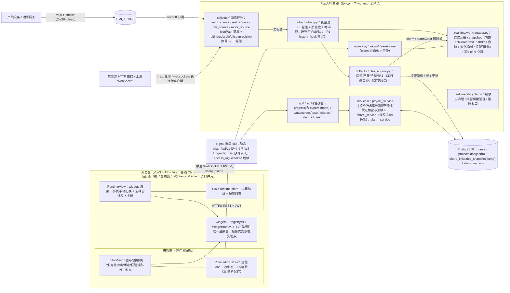

# 专项深化文档：整体架构与前后端目录结构

> 产品：Web 原生轻量低代码组态实时监控大屏（只读监控，开源核心 P0 + 企业版 P2）。本文档为《整体架构与前后端目录结构》专项深化定稿，骨架方案为 mvp-first，命名沿用骨架，偏离项见第 0 章。全中文说明，代码标识符/路径/接口名英文。接口前缀统一 `/api/v1`，运行态 WS 端点 `/api/v1/ws/runtime`。

---

## 0. 与骨架的差异清单（评审缺陷闭环，均已落入后文设计）

| # | 差异内容 | 原因 | 影响位置 |
|---|---|---|---|
| 1 | **换算上移变量级**：`VariableDef` 增加可选 `bitIndex`（位提取）与 `scale/offset/precision`，服务端采集入 hub 前完成换算，hub 内只流转**工程值**；`Binding` 上无数值换算字段，仅保留表现层 `mapping`（enum/range 映射）。报警阈值一律按工程值口径配置与评估 | 评审必改：消除“界面显示工程单位、报警按原始值判定”的口径分叉 | §3.3 K9、schemas/doc/variable.py、collector/transform.py、前端 shared/transform.ts |
| 2 | **分享改为快照方案**：`share_links` 增加 `doc_snapshot JSONB` 列，签发/手动刷新时冻结脱敏后的 doc 副本；公开端点只读快照；停用即失效（置 `revoked_at`）。不引入 draft/publish 状态机、无 `published_doc` 列，“发布”语义 = 创建或刷新分享链接。新增接口 `POST /api/v1/shares/{token}/refresh` | 评审移植：避免编辑半成品直接透出到已分享大屏，保住“一键发布”语义 | §3.3 K10、share_service、api/shares.py |
| 3 | **凭证治理**：doc 所有出口（GET 工程详情/导出/分享快照）中 datasource 的 `password` 置空、headers 敏感键置空（`username` 不脱敏）；库内凭证用 Fernet 对称加密（`cryptography`，密钥 `.env:DATASOURCE_SECRET`）；PUT 合并规则：缺省/空串 = 保留库内原值、显式 null = 清除；导入文件中凭证一律视为空。导出文件不携带凭证，重新导入后需在数据源面板重填 | 评审必改：公开分享/导出即泄漏 EMQX/REST 凭证 | §3.3 K11、project_service、utils/encrypt.py |
| 4 | **新增接口**：`GET /api/v1/health`（存活检查，compose healthcheck 用）、`POST /api/v1/datasources/test`（数据源连通性测试，全局端点，body 即数据源配置，超时 5s）、`PUT /api/v1/auth/password`（改密，body `{oldPassword,newPassword}`）、`POST /api/v1/shares/{token}/refresh`（快照刷新）、`GET /api/v1/projects/{id}/variables/values`（编辑器调试值快照） | 评审指出：三方案共同缺失 | §3.2 api/、接口偏离注记 |
| 5 | **新增后端模块**：`realtime/lifecycle.py`（运行期级联热清理、报警保留策略、重启收口）、`utils/ratelimit.py`（WS 限流）、`utils/timepolicy.py`（时间戳信任裁决）、`utils/encrypt.py`、`collector/transform.py`、`collector/jsonpath.py`、`realtime/frames.py` | 运行态级联清理、滥用防护、时间戳信任等评审共同缺陷的落点 | 第 5 章目录树 |
| 6 | **边界声明补全**：数据载荷仅支持 JSON（UTF-8，点路径提取），CSV/十六进制/二进制协议不支持；浏览器基线 Chrome/Edge ≥ 90，不支持 IE；MQTT 统一 QoS0 + clean session（QoS1 亦无持久会话，无离线回放）；时间戳信任策略统一（数据源级可选 `tsPath`，载荷时间戳与服务器偏差 > ±5min 双向、含未来时间，回退服务器时间并记 warn） | 评审共同缺陷 #4/#5、第三组 #5/#6 | §3.3 K14/K15、§7 |
| 7 | **报警与绑定样式优先级统一规则**：静态 props < 绑定映射 < 报警态三级；数值/颜色类属性报警优先（报警态覆盖组件填充色并叠加闪烁动画，恢复后自动回落）；`visible` 绑定优先于报警（隐藏即隐藏）。规则唯一实现点为 `widgets/WidgetHost.vue` | 评审共同缺陷 #1：双链路命中歧义 | §3.3 K12 |
| 8 | **告警记录保留策略**：`alarm_records` 每日定时清理（默认保留 30 天，env `ALARM_RETENTION_DAYS` 可配，另设单工程行数上限 200000，env `ALARM_MAX_ROWS_PER_PROJECT`）；server 启动时将遗留 `active` 记录统一收口为 `recovered`；报警帧活动条数上限 200（超出按 critical > warn > info 保留并带 `truncated` 标记）；同规则前端提示音节流（`soundThrottleSec` 默认 60，critical 循环音手动可停） | 评审共同缺陷 #2 + 防风暴移植项 | lifecycle.py、stores/alarm.ts |
| 9 | **P1 演进挂点**：hub 写值路径预留 `history_hook` 接口（P0 空实现），P1 的 24h 回放仅在该钩子接入，不改采集/实时核心 | 评审：数据契约必须支撑演进 | collector/hub.py |
| 10 | **编辑器删除级联**：删除变量/数据源时前端先做引用扫描，存在引用则经确认后一并删除关联绑定与报警规则（组件属性回落静态值）；服务端 PUT 时仍做最终引用完整性校验（422 + 字段路径），双保险 | 评审共同缺陷 #3：三家皆缺编辑态删除路径 | §3.1 editor store、§3.2 project_service |
| 11 | **WS 依赖补全**：`pyproject.toml` 显式增加 `websockets`——既作为 uvicorn 的 WS 协议后端（裸 uvicorn ≥0.11 不含 WS 协议实现），又作为 `ws_source.py` 上游 WebSocket 客户端实现（httpx 官方不支持 WS 客户端，aiomqtt 仅支持 MQTT） | 评审必改：缺此依赖则 `/api/v1/ws/runtime` 握手失败、上游 WS 数据源落地即不可运行 | §5 pyproject 注释、§3.2 ws_source / api.ws 行 |

其余骨架内容（K1–K8 决策、双模式、100ms 合帧、jsonb 整文档、单 worker、四容器部署、量化基线）全部保留。

---

## 1. 总体设计原则

1. **能简则简**：单机 4 容器；单 FastAPI 进程内完成采集、换算、规则评估、推送；不引入 Redis/消息队列；工程数据单 jsonb 文档整存整取。
2. **编辑态与运行态共用唯一组件渲染器**（`web/src/widgets/*`），编辑态仅外包裹选中/操作层。
3. **全链路只读**：采集器只订阅/只拉取，系统不存在任何下行设备写通道；Modbus/OPC-UA/PLC 仅在 `collector/drivers/` 预留接口位（P2，开源核心不实现）。
4. **口径唯一**：变量换算只发生在服务端入池前一处（含 `bitIndex` 位提取）；前端不做第二次数值换算；报警、显示、测试注入共用“工程值”一个口径（注入入口仅存在于编辑态预览，纯前端本地覆盖 runtime store，不落库不经服务端）。
5. **边界内声明**（写入产品文档）：不做 3D/历史时序库/主备冗余/视频；不做控制写入；数据载荷仅 JSON；浏览器基线 Chrome/Edge ≥ 90，深拷贝用自写 util 不用 `structuredClone`。

---

## 2. 架构图

### 2.1 逻辑架构（编辑态/运行态双模式 + 后端模块 + 数据流）



**模块间数据流向（编号对应上图）：**

1. **编辑保存流**：编辑器改 Pinia `editor` store → 3s 防抖 `PUT /api/v1/projects/{id}`（全量 doc + `baseRevision`）→ project_service：schemaVersion 等值校验（不符 422 `version_unsupported`，迁移唯一实现点在前端 `migrateDoc()`）→ doc 体积校验（> 2MB 422 `doc_too_large`）→ Pydantic 校验 → 引用完整性校验（失败 422 列字段路径）→ 凭证合并（缺省/空串 = 保留库内值、显式 null = 清除）→ 凭证 Fernet 加密 → 覆盖 `projects.doc`（`revision` 自增，响应返回新 revision）→ 触发该工程**软重载**（collector/registry 差量重建采集任务、hub 值池清空置 stale、WS 广播新 snapshot、规则集热更新；**不断开任何连接**）。
2. **发布/分享流**：编辑器分享面板 `POST /api/v1/projects/{id}/shares` → share_service 将库内 doc **脱敏后冻结**进 `share_links.doc_snapshot` → 观者打开 `/s/{token}` → `GET /api/v1/share/{token}` 返回快照 doc → 建连 `WS /api/v1/ws/runtime?project={id}&token={shareToken}` 收实时值。停用/过期 → lifecycle 推 `error` 帧后断开；refresh 快照 → 向相关连接广播 `reload` 帧（客户端重拉快照），不断开。
3. **采集换算流**：四源任务按变量 `address + jsonPath` 提取**原始值** → `transform.py` 按变量级换算链一次换算为**工程值**（可选 `bitIndex` 位提取：`raw=(ToInt(raw)>>bitIndex)&1`，仅 number 且配置了 bitIndex 时 → `scale/offset` → `precision`）→ 附 `t`（时间戳，按 timepolicy 裁决：数据源级可选 `tsPath`，偏差 > ±5min 双向含未来时间回退服务器时间并记 warn）与 `q`（good/stale/bad）→ 写入 hub。
4. **规则评估流**：hub 每次写值 → rules_engine 取该工程 enabled 规则（工程值 vs 阈值比较，含 hysteresis/durationMs）→ 触发：插 `alarm_records(active)` + 向 ws_manager 发即时 `alarm` 帧；恢复：更新记录 + `alarmClear` 帧。
5. **分发流**：hub 写值 → ws_manager 100ms 合并窗口，仅含变化变量（变化抑制），广播 `values` 帧；服务端 `ping` 心跳 20s、2 次无 pong 判死。
6. **前端渲染流**：runtime store 收帧更新工程值池 → `binder.ts` 求值（仅 `mapping` enum/range 映射与显隐，无数值换算）→ `WidgetHost.vue` 按 K12 优先级合成绑定值与报警态 → 组件响应式渲染；趋势图前端 600 点环形缓冲。
7. **级联清理流**：lifecycle 触发器仅有三类——**删工程**（推 `error` PROJECT_REMOVED 后断开 + 取消采集任务 + 清 hub 工程通道 + 活动报警收口）、**停用分享**（推 `error` SHARE_REVOKED 后断开 + 清理该 token 连接）、**refresh 快照**（仅广播 `reload` 帧，不断开）。导入总是新建工程，**不存在“导入覆盖”触发器**；普通 PUT 保存走数据流 1 的软重载，不进入本流程。
8. **重启恢复流**：server 启动 → `UPDATE alarm_records SET status='recovered' WHERE status='active'` → 采集任务全量重建 → 首帧到达前前端显示 stale。

**运行口径披露（G32）**：变量删除/改名/换绑保存后，引擎按最新 doc 运行；已分享快照中的旧变量无值流，刷新快照即恢复，属预期行为。

### 2.2 docker-compose 部署拓扑（单机）

| 服务 | 镜像 | 端口 | 职责与要点 |
|---|---|---|---|
| nginx | nginx:1.27-alpine | 80（唯一对外入口） | 托管 `web/dist`；`/api/v1` 反代（含 WebSocket Upgrade）；`/s/` 路径不设 `X-Frame-Options`、按需 `Content-Security-Policy: frame-ancestors *`；**access_log 对 `/api/v1/ws/runtime` 与全部 `/api` 请求做 token/凭证脱敏（查询串掩码，P0 交付基线）** |
| server | 自建多阶段 Dockerfile（pip 清华源） | 8000 仅内网 | FastAPI + 采集器 + 规则引擎 + WS 网关 + lifecycle；启动前 `alembic upgrade head`；healthcheck = `GET /api/v1/health`；`restart: always` |
| postgres | postgres:16-alpine | 5432 仅内网 | `users / projects(doc jsonb, revision) / share_links(doc_snapshot jsonb) / alarm_records`；volume 持久化 |
| emqx | emqx/emqx:5.10（Docker tag 为字面量、不支持通配，落地 compose 时固定为 5.x 系列当期实际存在的稳定版本 tag） | 1883 / 18083 仅内网 | MQTT 接入，管理台仅内网 |

管理员账号由 `scripts/create_admin.py` 按 `.env` 的 `ADMIN_USER/ADMIN_PASSWORD` 幂等初始化；无注册接口（单团队）。无 Redis、无 MQ。

---

## 3. 模块职责边界与关键设计决策

### 3.1 前端模块

| 模块 | 职责 | 边界（不做） |
|---|---|---|
| `src/router` | 路由：`/login` `/projects` `/editor/:id` `/run/:id` `/s/:token`；`/s/` 免登录 | 不做权限路由守卫（单团队，P2） |
| `src/api` | axios 实例 + JWT 拦截器 + 统一错误体 + 409 REVISION_CONFLICT 乐观锁冲突处理 + auth/projects/shares/alarms 模块 | 不做请求重试队列 |
| `src/stores/editor.ts` | 持有全量 doc、选中集、图层操作、成组解组、undo/redo 快照栈（上限 50，提交式入栈）、保存防抖 3s（PUT 携带 `baseRevision`）、**删除变量/数据源前的引用扫描与级联确认**（差异 #10） | 不做多人协同（P2） |
| `src/stores/runtime.ts` | 工程值池（v/q/t）、当前页；**测试注入仅存在于编辑态预览**：注入值纯前端本地覆盖 runtime store，不落库不经服务端（注入原始值经 `shared/transform.ts` 同构换算，编辑器复用本 store 实现） | 不缓存历史（趋势缓冲在组件内）；`/run/:id` 与 `/s/{token}` 运行态不提供注入入口 |
| `src/stores/alarm.ts` | 报警列表（上限 200 条）、全局报警条按 level 变色、徽标计数、**同规则提示音节流（`soundThrottleSec` 默认 60，设置存 doc.settings.alarm）**、静音开关持久化 localStorage | 不做报警确认 ack（P1） |
| `src/types/doc.ts` + `migrations.ts` | 与服务端 `schemas/doc/` 同构的 TS 类型；`migrateDoc()` 迁移链（**schemaVersion 迁移唯一实现点**，服务端只校验版本） | — |
| `src/shared/transform.ts` | 与后端 `collector/transform.py` 同规则的工程值换算函数（含 bitIndex 位提取链），**仅在编辑器注入预览这一条路径调用**（编辑器复用 runtime store 实现）；运行态值已由服务端换算，不重复调用 | 运行态不做数值换算、无任何调用点 |
| `src/widgets` | registry 协议（type → 元信息/默认 props/属性面板 schema/渲染器）+ `WidgetHost.vue`（绑定求值装配 + 报警态叠加，K12 唯一实现点）+ 基础 5 / 图表 7 / 设备 5 组件；设备类 SVG 动画限 transform/opacity 合成层 | button 纯静态占位，无点击动作（P1 预留）；不做 3D/视频 |
| `src/editor` | 三栏布局、CanvasStage（缩放平移）、SelectionLayer（8 向柄/旋转）、AlignGuides（5px 吸附）、框选成组、history.ts、各面板（含数据源“测试连接”按钮、变量注入面板、分享管理） | 不做组件复制粘贴（未列入 P0） |
| `src/runtime` | RuntimeView、AdaptiveContainer（fixed/fit-width/fit-height/fit-contain/stretch 五模式 `transform: scale`）、ws.ts（指数退避重连 1s 起上限 30s、30s 无入站帧主动重连、致命 error code 停止重连，重连后以 snapshot（内嵌 activeAlarms）整体覆盖）、binder.ts、AlarmBar（报警条 + “点击启用声音”解锁提示）、alarmSound.ts（Web Audio，critical 循环手动可停） | 不做按页订阅（连接即全工程订阅，`subPages` 为 P2 预留）；不提供测试注入入口 |

### 3.2 后端模块

| 模块 | 职责 | 边界（不做） |
|---|---|---|
| `api/health.py` | `GET /api/v1/health` 公开存活检查（compose healthcheck） | — |
| `api/auth.py` | login / logout（进程内 jti 黑名单）/ me / `PUT /api/v1/auth/password` 改密（body `{oldPassword,newPassword}`，旧密码校验）/ 登录失败锁定（5 次锁 60s，内存计数） | 无注册、无用户管理 |
| `api/projects.py` | CRUD（POST 创建不携带 doc）；`GET /api/v1/projects/{id}/export` 导出（JSON body，前端 Blob 下载）、`POST /api/v1/projects/import` 导入（校验→引用完整性→重新生成 project.id 回写 doc，G7/G9）；`GET /{id}/variables/values` 编辑器调试值快照（G28）；PUT 全量 + `baseRevision` 乐观锁（409 REVISION_CONFLICT，返回新 revision） | 不做版本历史（P2） |
| `api/datasources.py` | `POST /api/v1/datasources/test`（全局端点）：body 即数据源配置，临时建连测试（mqtt 连接+订阅 / rest 单次请求 / ws 建连 / mock 直接 ok），超时 5s，出参 `{ok, type, latencyMs, message}`（G23） | 不探测写通道（系统无下行） |
| `api/shares.py` | 签发（冻结脱敏快照）/枚举/停用（置 `revoked_at`）/`refresh` 快照/公开只读读取（token 即凭证） | 不做访问密码（K6 维持骨架建议）、无 publish 状态机 |
| `api/alarms.py` | 报警记录分页查询（active/recovered，`?page=&size=` → `{total,page,size,items}`） | 不做 ack 与统计（P1）；分享页报警走 WS，无公开 REST（G28） |
| `api/ws.py` | `/api/v1/ws/runtime` 握手：token（JWT 或 shareToken）校验 + ratelimit 限流检查 → **统一 accept 后校验，失败推 `error` 帧再 close 4000（握手阶段不做 HTTP 分支拒绝；唯一例外 PROJECT_MISMATCH 保持连接）** → 注册进 ws_manager；**WS 协议由 uvicorn + websockets 协议后端承载（pyproject 已显式声明 websockets，缺失则握手失败）** | 浏览器 WS 无法带 Header，token 走查询串（安全依赖 HTTPS + 日志脱敏） |
| `services/project_service.py` | 保存/导入流水线、schemaVersion 等值校验（422 `version_unsupported`，**服务端不做迁移**，迁移唯一实现点在前端 `migrateDoc()`，G8）、doc 体积校验（> 2MB 422 `doc_too_large`，G21）、**引用完整性校验**（binding.variableId、alarmRule.variableId、variable.datasourceId、share.pageId，失败 422 + JSON 路径）、**凭证合并（缺省/空串 = 保留、null = 清除）+ Fernet 加密 + 全出口脱敏**（G6） | — |
| `services/share_service.py` | 快照冻结（冻结前脱敏）/失效/刷新 | 不做状态机、无 published_doc（G5） |
| `services/alarm_service.py` | 报警落库/恢复更新/查询/保留清理执行 | — |
| `collector/hub.py` | 变量池：工程值存取、q/t、按工程 Pub/Sub；**`history_hook` 预留（P0 空实现，P1 24h 回放唯一接入点，差异 #9）**；接口化预留 Redis pub/sub 替换（K4） | 实时值不落库 |
| `collector/base.py + registry.py` | SourceTask 抽象（start/stop/异常兜底循环，单源崩溃不拖垮其他源）；工程级任务表，保存后**差量重建**（软重载） | — |
| `collector/mqtt_source.py` | aiomqtt 订阅；**统一 clean session=true，默认 QoS0，QoS1 可选但无持久会话，重连不回放离线消息（K14）**；指数退避重连；重连成功发 snapshot 并清 stale | 只订阅不发布 |
| `collector/rest_source.py / ws_source.py / mock_source.py` | httpx 定时轮询（规避 CORS）/ 上游 WS 客户端（**websockets 库实现**：重连+心跳+上游订阅帧；httpx 官方不支持 WS 客户端，aiomqtt 仅支持 MQTT）/ Mock 生成器（sine/ramp/random/square，`DataSource.type='mock'` 的 `enabled` 即开关，无独立 mock 接口/表列，G13） | 载荷仅 JSON（差异 #6） |
| `collector/transform.py + jsonpath.py` | 工程值换算唯一实现点：变量级换算链 `bitIndex` 位提取（`raw=(ToInt(raw)>>bitIndex)&1`，仅 number 且配置了 bitIndex 时）→ `scale/offset` → `precision`；点路径提取（自研轻量，解析失败记 `q='bad'` 不抛异常） | — |
| `collector/rules_engine.py` | 阈值/回差/持续/恢复判定（工程值口径，K9）；规则热更新；活动报警广播上限 200（超出按 critical > warn > info 保留，带 `truncated`） | — |
| `realtime/ws_manager.py` | 连接注册、snapshot（内嵌 activeAlarms）下发、100ms 合帧 + 变化抑制、报警即时帧、20s ping / 2 次无 pong 判死、慢连接踢除 | — |
| `realtime/lifecycle.py` | 差异 #5/#8：级联热清理触发器仅三类——删工程（error 帧后断开 + 任务取消 + 值池清理 + 报警收口）、停用分享（error 帧后断开）、refresh 快照（仅广播 reload 帧，不断开；G17）；每日报警保留清理（默认 30 天 + 单工程行数上限 200000）；启动遗留 active 收口为 recovered。导入总是新建工程，不存在覆盖触发器 | — |
| `utils/ratelimit.py` | 内存滑动窗限流（K16/G16）：单 share token 并发运行态 WS ≤ 20（`SHARE_MAX_WS_PER_TOKEN`）、同用户同工程 JWT WS ≤ 10（`JWT_WS_MAX_PER_USER_PROJECT`）、建连 ≤ 30 次/分（`RATE_LIMIT_CONNECT_PER_MIN`）、全实例 WS ≤ 50（`WS_MAX_CONNECTIONS`） | — |
| `utils/encrypt.py / timepolicy.py` | Fernet 凭证加解密；时间戳信任裁决（K15/G26：数据源级可选 `tsPath`，载荷时间戳与服务器偏差 > ±5min 双向含未来时间 → 回退服务器时间并记 warn） | — |
| `core/ models/ schemas/` | 配置；security.py：bcrypt 校验、PyJWT 签发/校验（含 logout 进程内 jti 黑名单）、shareToken 校验、登录失败锁定计数（内存）；SQLAlchemy 2.0 异步 ORM；Pydantic v2 全量 doc 模型（schemaVersion 等值校验，不符 422 `version_unsupported`） | — |

### 3.3 关键设计决策（K 系列）

> D 系列编号保留给《05-关键决策点》文档的用户拍板项（D1–D12）；本文档内部决策表一律使用 K 系列编号（G31），其中 K1–K8 沿骨架结论，K9–K16 为本轮新增/修订。

| # | 决策 | 结论 |
|---|---|---|
| K1 | MQTT 通路位置 | 后端 aiomqtt 桥接（浏览器只用原生 WebSocket） |
| K2 | 画布拖拽 | 自研绝对定位 pointer 实现；re-resizable 为 React 库不可用、vue-grid-layout 网格模型与自由布局冲突 |
| K3 | 工程存储 | 单 jsonb 整文档 + `revision INT` 乐观锁（PUT 带 `baseRevision`，冲突 409 REVISION_CONFLICT，G2） |
| K4 | Redis | 不引入；hub 接口化预留 |
| K5 | 推送帧 | JSON 文本帧 + 100ms 合帧；帧集合固定为 snapshot（内嵌 activeAlarms）/ values / alarm / alarmClear / reload / ping / pong / error（G19） |
| K6 | 分享模型 | 不记名 nanoid token + 过期 + 停用（“发布”语义 = 创建或刷新分享链接，快照方案，见 K10） |
| K7 | 图片资产 | 仅外链 URL，不入 doc |
| K8 | 趋势图 | 前端 600 点环形缓冲，刷新即清空 |
| **K9** | **换算口径** | 换算（`bitIndex` 位提取 + `scale/offset/precision`）属于变量语义，服务端入池前一次执行；hub 只流转工程值；**报警阈值、界面显示、注入测试面板统一按工程值口径**，写入告警协议文档（G3） |
| **K10** | **发布语义** | 快照：签发时脱敏冻结 `doc_snapshot`，编辑不影响已发布大屏；手动 refresh 更新（“发布”语义 = 创建或刷新分享链接）；停用即失效（置 `revoked_at`）；无 publish 状态机、无 published_doc 列 |
| **K11** | **凭证治理** | 库内 Fernet 加密（密钥 `.env:DATASOURCE_SECRET`）；出口必脱敏（`mqtt.config.password` 置空、rest/websocket headers 敏感键置空，`username` 不脱敏）；PUT/导入合并：缺省或空串 = 保留库内值、显式 null = 清除、导入文件中凭证一律视为空；导出不携带凭证 |
| **K12** | **报警/绑定样式优先级** | 静态 props < 绑定映射 < 报警态三级；报警态覆盖组件填充色并叠加闪烁动画（level 对应色），恢复后自动回落；`visible` 绑定优先于报警（隐藏即隐藏）。唯一实现点 `WidgetHost.vue` |
| **K13** | **多页订阅与流量上界** | P0 连接即全工程订阅（无 subscribe 帧）：值帧只含变化变量、报警帧活动上限 200（超出按 critical > warn > info 保留并带 `truncated` 标记），多页工程流量以此封顶；按页订阅 `subPages` 帧类型预留不实现（P2 规模化项） |
| **K14** | **MQTT 会话语义** | 统一 clean session=true；默认 QoS0，QoS1 可选但无持久会话，重连不回放离线消息，杜绝堆积值跳变与告警风暴 |
| **K15** | **时间戳信任** | 数据源级可选 `tsPath`（写入 `DataSource.config`）指定载荷时间戳点路径，缺省用服务器接收时间；提取值/帧内 `ts`（epoch ms）与服务器偏差 > ±5min（双向，含未来时间）视为不可信，改用服务器时间并记 warn；stale 判定与趋势缓冲均用裁决后时间 |
| **K16** | **公开面滥用防护** | 同一 share token 并发运行态 WS ≤ 20（env `SHARE_MAX_WS_PER_TOKEN`）、同一用户同一工程 JWT WS ≤ 10（env `JWT_WS_MAX_PER_USER_PROJECT`）、建连频率 ≤ 30 次/分（`RATE_LIMIT_CONNECT_PER_MIN`）、全实例 WS ≤ 50（`WS_MAX_CONNECTIONS`）；超限不做握手阶段分支化 HTTP 拒绝，统一 accept 后推 `error` 帧（RATE_LIMITED）再 close 4000，防 token 泄露拖垮单实例 |

---

## 4. 前端目录树（`web/`）

未标注者均为 **P0**；【P1 预留】【P2 预留】仅为扩展点声明，不实现。

```text
web/
├─ Dockerfile                      # P0 多阶段：node 构建 → nginx 托管 dist，npm 淘宝源
├─ vite.config.ts                  # P0 dev 代理 /api/v1 到 server；build target es2020（对应 Chrome/Edge ≥ 90 基线，深拷贝用自写 util 不用 structuredClone）
├─ index.html                      # P0 单页入口
└─ src/
   ├─ main.ts                      # P0 应用启动：Pinia/Router/Element Plus 挂载
   ├─ App.vue                      # P0 根组件与全局主题容器
   ├─ styles/
   │  └─ theme.css                 # P0 蓝色系 CSS 变量（blue-dark / blue-light 两套）
   ├─ router/
   │  └─ index.ts                  # P0 /login /projects /editor/:id /run/:id /s/:token 路由表
   ├─ api/
   │  ├─ http.ts                   # P0 axios 实例：JWT 拦截器、统一错误体、409 REVISION_CONFLICT 冲突转用户提示
   │  ├─ auth.ts                   # P0 login / me / PUT auth/password 改密
   │  ├─ projects.ts               # P0 项目 CRUD（POST 不携带完整 doc）+ export 导出（响应 JSON body，Blob 触发下载并命名）/ import 导入（独立端点）
   │  ├─ shares.ts                 # P0 签发 / 枚举 / 停用 / refresh 快照
   │  └─ alarms.ts                 # P0 报警记录查询
   ├─ stores/
   │  ├─ auth.ts                   # P0 token 与当前用户
   │  ├─ editor.ts                 # P0 全量 doc、选中集、成组解组、引用扫描与删除级联、保存防抖 + baseRevision
   │  ├─ runtime.ts                # P0 工程值池（v/q/t）、当前页；测试注入仅编辑态预览生效（纯前端本地覆盖本 store，不落库不经服务端；编辑器复用本 store）
   │  └─ alarm.ts                  # P0 报警列表（≤200）、报警条变色、徽标、同规则 60s 声音节流、静音持久化
   ├─ types/
   │  ├─ doc.ts                    # P0 工程 JSON 全量 TS 类型（与服务端 schemas/doc 同构；VariableDef 含 bitIndex/scale/offset/precision，key+label；Binding = { id, prop, variableId, mode: 'value'|'color'|'visibility', mapping?: { kind:'enum', map } | { kind:'range', bands } }，G4，以数据文档 §2.8 为准）
   │  ├─ ws.ts                     # P0 WS 帧类型（snapshot 含 activeAlarms / values / alarm / alarmClear / ping / pong / error / reload；P0 无 subscribe 帧）
   │  └─ migrations.ts             # P0 migrateDoc() schemaVersion 迁移链（迁移唯一实现点）
   ├─ shared/
   │  └─ transform.ts              # P0 工程值换算（与后端同规则），仅编辑器注入预览这一条路径调用；运行态不调用
   ├─ widgets/                     # ── 组件库（编辑态/运行态唯一共享渲染器）──
   │  ├─ registry.ts               # P0 type → 元信息/默认 props/属性面板 schema/渲染器（组件协议核心）
   │  ├─ WidgetHost.vue            # P0 统一挂载点：绑定求值装配 + 报警态叠加（K12 优先级唯一实现点）
   │  ├─ basic/
   │  │  ├─ TextWidget.vue         # P0 文本
   │  │  ├─ ImageWidget.vue        # P0 图片（外链 URL）
   │  │  ├─ TableWidget.vue        # P0 表格（el-table）
   │  │  ├─ ButtonWidget.vue       # P0 按钮（纯静态样式占位，可参与颜色/显隐绑定；无点击动作，P1 只读动作预留 props.action 不实现）
   │  │  └─ CarouselWidget.vue     # P0 轮播（el-carousel）
   │  ├─ chart/
   │  │  ├─ BaseChart.ts           # P0 ECharts 适配器基类：echarts/core 按需注册、实例复用、resize、刷新节流
   │  │  ├─ FlipCounterWidget.vue  # P0 数字翻牌（自研，不用 ECharts）
   │  │  ├─ LineChartWidget.vue    # P0 折线
   │  │  ├─ BarChartWidget.vue     # P0 柱状
   │  │  ├─ PieChartWidget.vue     # P0 饼图
   │  │  ├─ GaugeWidget.vue        # P0 仪表盘
   │  │  ├─ ProgressWidget.vue     # P0 进度条
   │  │  ├─ TrendChartWidget.vue   # P0 趋势图（绑定变量前端环形缓冲）
   │  │  └─ ringBuffer.ts          # P0 600 点环形缓冲实现
   │  └─ device/
   │     ├─ DeviceSvgBase.vue      # P0 SVG 图元动画基类：启停变色 / 管道流动 stroke-dashoffset / 闪烁
   │     ├─ deviceAnim.css         # P0 关键帧（仅 transform/opacity 合成层动画）
   │     ├─ StatusLightWidget.vue  # P0 状态灯
   │     ├─ MotorWidget.vue        # P0 电机
   │     ├─ PumpWidget.vue         # P0 泵
   │     ├─ ValveWidget.vue        # P0 阀门
   │     └─ PipeWidget.vue         # P0 管道
   ├─ editor/                      # ── 编辑态 ──
   │  ├─ EditorView.vue            # P0 三栏布局：左组件/图层，中画布，右属性
   │  ├─ history.ts                # P0 undo/redo 页面级 JSON 快照栈（上限 50，提交式入栈）
   │  ├─ keyboard.ts               # P0 快捷键：删除/撤销重做/方向键微调
   │  ├─ canvas/
   │  │  ├─ CanvasStage.vue        # P0 画布容器：Ctrl+滚轮缩放、空格平移、设计坐标系换算
   │  │  ├─ SelectionLayer.vue     # P0 选中框、8 向缩放柄、旋转柄
   │  │  ├─ AlignGuides.ts         # P0 吸附与对齐参考线（阈值 5px 设计坐标）
   │  │  ├─ MarqueeSelect.vue      # P0 框选多选
   │  │  └─ group.ts               # P0 成组/解组与组内相对坐标换算
   │  └─ panels/
   │     ├─ PagePanel.vue          # P0 页面增删排序、页面背景与自适应模式
   │     ├─ LayerPanel.vue         # P0 图层树（显隐/锁定/排序，组嵌套）
   │     ├─ PropPanel.vue          # P0 registry schema 驱动的属性面板
   │     ├─ VariablePanel.vue      # P0 变量字典 + 测试注入面板（仅编辑态；注入原始值经 shared/transform 换算预览）
   │     ├─ BindingEditor.vue      # P0 绑定编辑（属性路径/变量选择/mapping（enum→map / range→bands）映射表格）
   │     ├─ DataSourcePanel.vue    # P0 数据源配置 + "测试连接"按钮（调 datasources/test）
   │     ├─ AlarmRulePanel.vue     # P0 报警规则配置（op/threshold/level/hysteresis/durationMs，阈值按工程值口径；全局报警声音/级别设置存 doc.settings.alarm（soundEnabled/levelColors/soundThrottleSec 默认 60），随工程 doc PUT 保存，无独立端点）
   │     └─ SharePanel.vue         # P0 分享管理：签发/复制链接/refresh 快照/停用
   ├─ runtime/                     # ── 运行态 ──
   │  ├─ RuntimeView.vue           # P0 运行渲染 + 多页手动页签切换（自动轮播 P1 预留，doc 不加字段）+ 全屏大屏模式
   │  ├─ AdaptiveContainer.vue     # P0 五种自适应（fixed/fit-width/fit-height/fit-contain/stretch，transform:scale）
   │  ├─ ws.ts                     # P0 原生 WebSocket：退避重连（1s 起、上限 30s）、致命 error code 停止重连并提示人工介入（PROJECT_MISMATCH 例外保持连接）、snapshot（含 activeAlarms）/values/alarm/alarmClear/reload 帧处理、心跳、30s 无入站帧主动重连
   │  ├─ binder.ts                 # P0 绑定求值：仅 mapping（enum/range）映射与显隐（数值换算已在服务端完成）
   │  ├─ AlarmBar.vue              # P0 全局报警条（level 变色/徽标/列表）+ "点击启用声音"解锁提示条
   │  └─ alarmSound.ts             # P0 Web Audio 提示音：首次手势 resume、critical 循环手动可停
   └─ utils/
      ├─ nanoid.ts                 # P0 id 生成封装（doc 内部对象 id 均由此生成，导入时保留；前缀建议值非校验：page_/cmp_/var_/ds_/bnd_/alm_，G33）
      ├─ coord.ts                  # P0 屏幕↔设计坐标、组坐标系换算
      ├─ debounce.ts               # P0 防抖节流
      └─ download.ts               # P0 工程 JSON 导出 Blob 下载与文件命名（凭证已在服务端出口脱敏，响应头不使用非 ASCII 文件名）
```

测试：`web/tests/`（vitest）——`transform.spec.ts`（与后端换算同构性）、`binder.spec.ts`、`migrations.spec.ts`，均 P0。

P1 组件（能耗/温湿度/OEE/回放）接入方式：仅向 `registry.ts` 增注册新 type 与新目录 `widgets/extend/`，不改既有模块（扩展点声明，不建目录）。

---

## 5. 后端目录树（`server/` 与仓库根）

```text
webscada/
├─ docker-compose.yml              # P0 四服务编排（nginx/server/postgres/emqx），server healthcheck 指向 /api/v1/health
├─ .env.example                    # P0 JWT_SECRET / DATASOURCE_SECRET / POSTGRES_* / ADMIN_USER / ADMIN_PASSWORD
│                                  #    / EMQX_* / ALARM_RETENTION_DAYS / ALARM_MAX_ROWS_PER_PROJECT
│                                  #    / WS_MAX_CONNECTIONS / SHARE_MAX_WS_PER_TOKEN
│                                  #    / JWT_WS_MAX_PER_USER_PROJECT / RATE_LIMIT_CONNECT_PER_MIN
├─ deploy/
│  └─ nginx/nginx.conf             # P0 静态托管、/api/v1 反代（WS Upgrade）、/s/ 嵌入策略、access_log token 掩码（map $arg_token）
├─ docs/                           # P0 架构说明 / WS 协议 / 组件协议 / 告警口径（工程值）/ 部署与使用手册
├─ scripts/
│  └─ create_admin.py              # P0 按 .env 幂等初始化管理员（无注册接口）
└─ server/
   ├─ Dockerfile                   # P0 多阶段构建，pip 清华源，分层缓存
   ├─ pyproject.toml               # P0 fastapi / uvicorn / websockets / sqlalchemy[asyncio] / asyncpg / alembic
   │                               #    / pydantic-settings / aiomqtt / httpx / pyjwt / bcrypt / nanoid / loguru
   │                               #    / cryptography / pytest
   │                               #    websockets 双职责（差异 #11）：uvicorn 的 WS 协议后端——裸 uvicorn 自 0.11 起
   │                               #    不含 WS 协议实现，/api/v1/ws/runtime 握手依赖它；同时是 ws_source.py 上游
   │                               #    WS 客户端实现——httpx 官方不支持 WS 客户端，aiomqtt 仅支持 MQTT
   ├─ alembic.ini                  # P0
   ├─ alembic/
   │  └─ versions/0001_init.py     # P0 users / projects(含 revision) / share_links(含 doc_snapshot jsonb) / alarm_records；
   │                               #    索引：share_links(token)、alarm_records(project_id, triggered_at DESC)、projects(owner_id)
   ├─ app/
   │  ├─ main.py                   # P0 lifespan：启停采集任务/规则引擎/ws_manager/lifecycle 定时任务；挂载路由；/api/v1/health
   │  ├─ core/
   │  │  ├─ config.py              # P0 pydantic-settings 读取 .env
   │  │  ├─ security.py            # P0 bcrypt 校验、PyJWT 签发/校验（含 logout 进程内 jti 黑名单）、shareToken 校验、
   │  │  │                         #    登录失败锁定计数（5 次锁 60s，内存实现，不落库）
   │  │  └─ deps.py                # P0 当前用户依赖、异步 DB 会话依赖
   │  ├─ models/                   # P0 SQLAlchemy 2.0 异步 ORM（Mapped/mapped_column）
   │  │  ├─ user.py                # P0
   │  │  ├─ project.py             # P0 doc JSONB + revision INT 自增（乐观锁基准）
   │  │  ├─ share_link.py          # P0 token/revoked_at/expires_at/last_access_at/doc_snapshot JSONB（停用 = 置 revoked_at）
   │  │  └─ alarm_record.py        # P0 status active|recovered、rule_id/variable_key/value/level/message 快照、triggered_at/recovered_at
   │  ├─ schemas/
   │  │  ├─ doc/                   # P0 工程 JSON 全量 Pydantic v2 模型（schemaVersion 等值校验，不符 422 version_unsupported；服务端不做迁移，迁移唯一实现点在前端 migrateDoc()）
   │  │  │  ├─ project_doc.py      # P0 ProjectDoc/ProjectMeta（name ≤ 128 字符，G33）/ProjectSettings（含 settings.alarm 报警声音/级别设置）/AdaptiveMode
   │  │  │  ├─ page.py             # P0 Page/ComponentNode/WidgetType（含 group 递归）
   │  │  │  ├─ variable.py         # P0 VariableDef（key+label，G25；变量级换算链：bitIndex 位提取
   │  │  │  │                      #    raw=(ToInt(raw)>>bitIndex)&1，仅 number 且配置了 bitIndex 时 → scale/offset → precision，G3）
   │  │  │  │                      #    /Binding（mode: value|color|visibility + mapping enum/range，无数值换算字段）
   │  │  │  ├─ datasource.py       # P0 四类 DataSource（mqtt/websocket/rest/mock，config 内含可选 tsPath）
   │  │  │  └─ alarm_rule.py       # P0 AlarmRule（op/threshold/level/hysteresis/durationMs，阈值按工程值口径）
   │  │  └─ api/                   # P0 接口出入参 + 统一错误体 {"code","message","errors":[{path,message}]}（G20）
   │  │     ├─ auth.py / project.py / share.py / alarm.py / datasource.py / common.py   # P0
   │  ├─ api/
   │  │  ├─ health.py              # P0 GET /api/v1/health（公开，无鉴权）
   │  │  ├─ auth.py                # P0 login / logout（进程内 jti 黑名单）/ me / PUT auth/password 改密 /
   │  │  │                         #    登录失败锁定（5 次锁 60s 内存计数）
   │  │  ├─ projects.py            # P0 CRUD（POST 创建不携带完整 doc）；GET /{id}/export 导出；POST /import 导入（校验→引用完整性→重新生成 project.id 回写 doc）；GET /{id}/variables/values 调试值快照；PUT 全量 + baseRevision（409 REVISION_CONFLICT，返回新 revision）
   │  │  ├─ datasources.py         # P0 POST /api/v1/datasources/test 连通性测试（全局端点，body 即数据源配置，超时 5s，出参 {ok,type,latencyMs,message}）
   │  │  ├─ shares.py              # P0 管理端 /projects/{id}/shares 列表/创建、DELETE /shares/{token} 停用、POST /shares/{token}/refresh；公开端 /share/{token} 只读快照
   │  │  ├─ alarms.py              # P0 报警记录分页查询（?page=&size= → {total,page,size,items}，P1 历史统计预留）
   │  │  └─ ws.py                  # P0 /api/v1/ws/runtime：token 校验 + ratelimit → accept 后 error 帧语义（close 4000）→ 注册 ws_manager（WS 协议后端=websockets）
   │  ├─ services/
   │  │  ├─ project_service.py     # P0 保存/导入流水线、schemaVersion 等值校验、doc 体积校验（>2MB 422 doc_too_large）、引用完整性校验（422+字段路径）、凭证合并/加密/出口脱敏
   │  │  ├─ share_service.py       # P0 快照冻结（冻结前脱敏）/失效/刷新
   │  │  └─ alarm_service.py       # P0 落库/恢复更新/查询/保留清理执行
   │  ├─ collector/                # ── 数据采集层（全部只读，无下行写）──
   │  │  ├─ base.py                # P0 SourceTask 抽象：start/stop、异常兜底循环（单源崩溃不拖垮其他源）
   │  │  ├─ registry.py            # P0 工程级采集任务管理：保存后差量重建（软重载）
   │  │  ├─ hub.py                 # P0 变量池：工程值存取（v/q/t）、进程内 Pub/Sub、history_hook 预留【P1 挂点，P0 空实现】、Redis 替换接口位【P2】
   │  │  ├─ transform.py           # P0 工程值换算（口径唯一实现点，K9）：变量级换算链 bitIndex 位提取
   │  │  │                         #    （raw=(ToInt(raw)>>bitIndex)&1，仅 number 且配置了 bitIndex 时）→ scale/offset → precision
   │  │  ├─ jsonpath.py            # P0 点路径提取（自研轻量；失败记 q='bad' 不抛异常）
   │  │  ├─ mqtt_source.py         # P0 aiomqtt 订阅；QoS0+clean（QoS1 可选无持久会话，K14）；退避重连
   │  │  ├─ rest_source.py         # P0 httpx.AsyncClient 定时轮询
   │  │  ├─ ws_source.py           # P0 上游 WebSocket 客户端（websockets 库实现：重连+心跳+subscribeFrame）
   │  │  ├─ mock_source.py         # P0 Mock 生成器（sine/ramp/random/square，DataSource.type='mock' 的 enabled 即开关）
   │  │  ├─ rules_engine.py        # P0 阈值/回差/持续/恢复（工程值口径）；热更新；活动报警广播上限 200（超出按 critical > warn > info 保留，带 truncated）
   │  │  └─ drivers/README.md      # 【P2 预留】Modbus-TCP/OPC-UA/PLC 原生驱动接口位（仅声明，不实现）
   │  ├─ realtime/
   │  │  ├─ ws_manager.py          # P0 连接注册、snapshot（内嵌 activeAlarms）下发、100ms 合帧+变化抑制、报警即时帧、20s ping/40s 判死、慢连接踢除
   │  │  ├─ frames.py              # P0 帧类型定义与构造（snapshot 全量 + values 增量，变量以 variable.key 标识；error 帧：close 4000，code 枚举 TOKEN_EXPIRED / PROJECT_REMOVED / SHARE_REVOKED / SHARE_EXPIRED / RATE_LIMITED / PROJECT_MISMATCH（不关闭连接）/ INTERNAL_ERROR；reload 帧：快照刷新通知，客户端重拉 doc）
   │  │  └─ lifecycle.py           # P0 级联热清理（触发器仅三类：删工程/停用分享 → error 帧+断开+任务取消+值池清理；
   │  │                            #    refresh 快照 → reload 帧不断开；导入总是新建工程，不存在覆盖触发器）、
   │  │                            #    每日报警保留清理（默认 30 天 env ALARM_RETENTION_DAYS + 单工程 200000 行 env ALARM_MAX_ROWS_PER_PROJECT）、启动遗留 active 收口为 recovered
   │  └─ utils/
   │     ├─ encrypt.py             # P0 Fernet 凭证加解密
   │     ├─ ratelimit.py           # P0 内存滑动窗限流（K16：share token 并发/JWT 用户工程并发/建连频率/全局上限）
   │     └─ timepolicy.py          # P0 时间戳信任裁决（K15：数据源级 tsPath 指定载荷时间戳点路径，缺省回退服务器接收时间 / 偏差 > ±5min 双向含未来时间 → 回退服务器时间并记 warn）
   └─ tests/                       # P0 pytest（round-trip 为必过项）
      ├─ test_doc_schema.py        # P0 doc 模型校验与 schemaVersion 等值拒绝（version_unsupported）
      ├─ test_roundtrip.py         # P0 导出→导入→再导出 diff 为空（除 project.id/时间戳/凭证字段外）；含“清除凭证（显式 null）后导出导入”用例
      ├─ test_referential.py       # P0 引用完整性：孤儿 variableId/datasourceId/pageId → 422 + 字段路径
      ├─ test_credential_mask.py   # P0 出口脱敏与凭证合并规则（缺省/空串保留、显式 null 清除）
      ├─ test_jsonpath.py          # P0 点路径提取与异常输入
      ├─ test_transform.py         # P0 工程值换算（与前端 shared/transform 同构性用例）
      ├─ test_rules_engine.py      # P0 阈值/回差/持续/恢复/防风暴上限
      └─ test_ws_frames.py         # P0 100ms 合帧、变化抑制、报警即时帧
```

职责边界一句话（沿骨架并扩展）：`collector` 只管“把数据变成工程值”（含换算与质量位），`realtime` 只管“把值与报警送到浏览器并管理连接生命周期”，`services` 只管“文档合法性、凭证与快照”，`web/editor` 只管“改文档”，`web/runtime` 只管“按快照文档 + 实时工程值渲染”，`widgets` 是两侧共享的唯一组件实现。

---

## 6. 评审缺陷闭环对照表

| 评审问题 | 本文档落点 |
|---|---|
| 凭证脱敏（分享/导出泄漏） | 差异 #3、K11、project_service、test_credential_mask |
| 导入/保存引用完整性 422 | 差异 #1/#10、project_service、test_referential |
| 发布快照（编辑不透出已分享大屏） | 差异 #2、K10、share_service、api/shares.py |
| 换算位置与报警阈值口径统一 | 差异 #1、K9、collector/transform.py、shared/transform.ts |
| GET /api/v1/health | 差异 #4、api/health.py、compose healthcheck |
| 报警防风暴（声音节流/上限 200/重启收口） | 差异 #8、rules_engine、lifecycle、stores/alarm.ts |
| 变量测试注入面板 | VariablePanel.vue（仅编辑态入口；注入原始值 → 本地同构换算预览） |
| 报警变色与绑定变色优先级 | K12（WidgetHost.vue 唯一实现点） |
| alarm_records 无限增长 | 差异 #8、lifecycle 定时清理 + 行数上限 |
| 编辑器删除变量/数据源级联 | 差异 #10、stores/editor.ts 引用扫描 + 服务端双保险 |
| 非 JSON 载荷边界 | §1 原则 5、差异 #6 |
| 浏览器兼容基线 | §1 原则 5、vite target es2020、不用 structuredClone（深拷贝自写 util） |
| 改密路径（PUT /api/v1/auth/password） | 差异 #4、api/auth.py password |
| 数据源连通性测试 | 差异 #4、api/datasources.py、DataSourcePanel 按钮 |
| P1 24h 回放演进挂点 | 差异 #9、hub.history_hook（P0 空实现） |
| WS 路径访问日志脱敏 | §2.2 nginx 表、deploy/nginx/nginx.conf |
| 量化规模上限 | §7（沿骨架基线） |
| 告警判定基准值语义 | K9（工程值口径，写入 docs/ 告警协议文档） |
| 运行态资源级联热清理 | 差异 #5、lifecycle.py + frames.error 帧（数据流 7，触发器仅删工程/停用分享/refresh 快照三类） |
| 公开面滥用防护 | K16、utils/ratelimit.py |
| 多页告警帧语义 | K13（连接即全工程订阅 + 流量上界，P0 无 subscribe 帧，subPages 预留） |
| MQTT QoS/离线回放语义 | K14 |
| 时间戳信任策略 | K15、utils/timepolicy.py（含数据源级 tsPath） |
| WS 运行依赖可运行性（uvicorn WS 后端 + 上游 WS 客户端） | 差异 #11、§5 pyproject 显式声明 websockets、§3.2 ws_source / api.ws 行标注（websockets 为真实库：uvicorn WS 协议后端 + ws_source 客户端；httpx 不支持 WS 客户端） |
| 注入口径唯一性（仅编辑态预览） | §3.1 runtime.ts / shared/transform.ts 行、§4 runtime.ts / transform.ts / VariablePanel.vue 行统一：注入仅存在于编辑态预览（纯前端本地覆盖 runtime store，不落库不经服务端），`/run/:id` 与 `/s/{token}` 运行态无注入入口；shared/transform.ts 仅该路径调用 |
| 分享页报警数据通道（无公开 REST） | G28（WS snapshot.activeAlarms + alarm/alarmClear 帧；REST 仅 `GET /api/v1/projects/{id}/variables/values` 编辑器调试） |
| 运行口径披露（快照旧变量无值流） | G32（数据流 1/7 注记：保存后引擎按最新 doc 运行，已分享快照旧变量无值流，刷新快照即恢复，属预期行为） |
| 内部决策表编号规范 | G31（D 系列编号保留给《05-关键决策点》用户拍板项，本文档决策表使用 K 系列） |
| EMQX 镜像 tag 具体化 | §2.2 emqx/emqx:5.10（Docker tag 为字面量、不支持通配，落地时固定为 5.x 系列实际存在的稳定 tag） |

---

## 7. 量化验收基线（P0 验收客观标尺）

| 项 | 基线 |
|---|---|
| 部署 | 单机 2C4G，`docker compose up -d` 一键启动，4 容器 |
| 并发 | 全实例 WS ≤ 50 连接；单 share token 并发运行态 WS ≤ 20（SHARE_MAX_WS_PER_TOKEN）；同用户同工程 JWT WS ≤ 10（JWT_WS_MAX_PER_USER_PROJECT）；建连 ≤ 30 次/分 |
| 规模 | ≤ 5000 变量/工程；单页 ≤ 200 组件（超出编辑器提示）；doc ≤ 1MB 编辑器 UI 告警、> 2MB 服务端 422（doc_too_large） |
| 时延 | 值刷新 500ms~1s 级；值帧合并窗口 100ms；报警帧即时 |
| 保存 | 编辑器防抖 3s；PUT 乐观锁冲突 409 REVISION_CONFLICT（成功返回新 revision） |
| 告警 | 记录默认保留 30 天（ALARM_RETENTION_DAYS）+ 单工程行数上限 200000（ALARM_MAX_ROWS_PER_PROJECT）；活动报警帧 ≤ 200 条（超出按 critical > warn > info 保留，带 truncated）；同规则提示音 60s 节流 |
| 兼容 | Chrome/Edge ≥ 90；不支持 IE |
| 数据 | 载荷仅 JSON；时间戳裁决阈值 ±5min（双向含未来时间，数据源级 tsPath 可选，缺省服务器接收时间）；MQTT 默认 QoS0 + clean session |
| 演示路径 | 无设备笔记本：mock 数据源 → 值跳动 → 图表刷新 → 设备图元变色/管道流动 → 越限报警 → 声音 + 变色 → 分享链接另一设备打开实时刷新 |